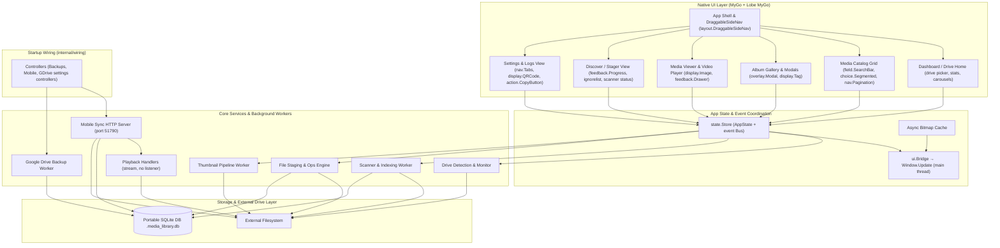

# Painless Implementation Architecture

Painless is a **100% native Go desktop media organizer for external drives**, ported from the Electrobun (Bun + React + DaisyUI) source app _External Drive Media Organizer (d-stream-desktop)_. The UI is pure Go on [MyGo](https://github.com/egoist/mygo) (`github.com/egoist/mygo/ui`) with GPU-accelerated components from [Lobe MyGo](https://github.com/lobehub/lobe-mygo). No web stack, no CGo.

This directory contains the feature-by-feature implementation specifications and architecture blueprints.

---

## 0. Agent TL;DR — Read This First

You do **not** need to read every spec to work safely on this codebase. Start here.

### What the app does

A user plugs in a removable drive (USB/HDD/SD card). Painless scans it, indexes every photo/video into a **portable SQLite database that lives on the drive itself** (`.media_library.db` at the drive root), deduplicates via SHA-256, extracts EXIF/video metadata, generates cached WebP thumbnails (`.media_thumbnails/` at the drive root), and organizes media into albums (directories on the drive). It ships a Dashboard (drive home), Media Catalog grid, Albums gallery, image/video Viewer, Discover (scanner + staging), and Settings (backups, mobile pairing, logs). A token-authenticated HTTP server (port **51790**) serves sync/upload/playback for a mobile companion. Google Drive cloud backup is optional.

### Core invariants (do not violate)

1. **The drive is the product boundary.** All library state (SQLite DB + thumbnail cache) lives on the indexed drive; nothing essential is stored on the host machine. The library travels with the drive.
2. **Safe against data loss.** Atomic moves, SHA-256 verification, collision handling, and online backup are non-negotiable. Never "just move" a user's only copy.
3. **Pure Go, `CGO_ENABLED=0`.** SQLite via `modernc.org/sqlite` (never `mattn/go-sqlite3`). Builds must stay CGo-free and cross-compilable (Linux/Windows/macOS).
4. **Native, never web-flavored.** UI is MyGo/Lobe MyGo widgets; follow `DESIGN.md`. Never introduce HTML/CSS thinking.
5. **No UI elements or `ui.Context` in app state or workers.** Elements expire at the end of each frame; store handles, model data, and `ui.Handle` instead. Slow work runs off the UI thread and publishes via `Window.Update` (see `internal/ui/bridge.go`).
6. **Thread safety.** `internal/state.AppState` is mutex-guarded; UI reads during build passes, workers mutate only through bridge callbacks / the event bus.

### Where things live (map of ~40 packages)

| Area          | Package(s)                                                                | One-liner                                                                                            |
| :------------ | :------------------------------------------------------------------------ | :--------------------------------------------------------------------------------------------------- |
| Entrypoint    | `main.go` (repo root, not `cmd/`)                                         | `mygo.App.WhenReady` → `shell.Open()`                                                                |
| Domain types  | `internal/domain`                                                         | MediaItem, Album, Tag, DriveInfo, StagedOperation, LogEntry                                          |
| Persistence   | `internal/storage` (+ `migrations/`)                                      | SQLite engine, WAL, repos, migrations **v1–v3**, `VACUUM INTO` backups                               |
| Drives        | `internal/drive`                                                          | Detection (`gopsutil`) + 3s polling monitor with events                                              |
| File ops      | `internal/fileops`                                                        | Atomic move, EXDEV copy fallback, `MoveFileNoReplace`, staging engine, rollback journal              |
| Scanner       | `internal/scanner`                                                        | Concurrent walker, MIME sniff, EXIF/duration, SHA-256 dedupe, dir→album resolver, ignorelist         |
| Thumbnails    | `internal/thumbnail`                                                      | ffmpeg encoder pool, WebP disk/memory cache, SIGSTOP/SIGCONT CPU throttler                           |
| Streaming     | `internal/server/stream`                                                  | Range-request playback + `/thumbnail` handlers; **mounted under the mobile server, no own listener** |
| Mobile sync   | `internal/server/mobile`                                                  | Token-auth REST + upload API, **port 51790**, mounts `stream.Routes`                                 |
| Cloud backup  | `internal/gdrive`                                                         | Google Drive API v3 service account upload of DB snapshots                                           |
| Logging       | `internal/logging`                                                        | Level-filtered logger + memory ring buffer                                                           |
| State         | `internal/state`                                                          | `AppState`, `Store`, event bus, selection, jobs, screen enum                                         |
| Wiring        | `internal/wiring`                                                         | Real settings controllers over live services (Backups/Mobile/GDrive); built once at startup          |
| UI theme      | `internal/ui/theme`                                                       | Color/typography/spacing tokens                                                                      |
| UI bridge     | `internal/ui/bridge.go`                                                   | Bus events → `Window.Update` on main thread                                                          |
| UI components | `internal/ui/components`                                                  | `mediacard` (card + skeleton tile), `mediagrid`                                                      |
| Screens       | `internal/ui/screens/{dashboard,catalog,albums,viewer,discover,settings}` | One package per screen                                                                               |
| Shell         | `internal/ui/shell`                                                       | Window, sidebar nav, drive bar, toasts, screen hosting, library wiring                               |

### Ground rules for changes

- **Coordination:** claim tasks in [`progress.md`](file:///run/media/destiny/Ventoy/dr_projects/painless/docs/implementation/progress.md) (section 3, Task Registry) before working; log completions in section 4.
- **Commits:** Conventional Commits per [`commit.md`](file:///run/media/destiny/Ventoy/dr_projects/painless/commit.md) (repo root, not docs/). CI derives SemVer from commit messages.
- **No monoliths:** strict package separation under `internal/`; keep files focused.
- **Tests are string-sensitive** on UI text (e.g. `"Media Details & EXIF"`, `"n of m"` counter format). Reproduce UI issues with `ui.NewTester`.
- **Verify before done:** `CGO_ENABLED=0 go test ./...`, `go test -race` on touched state-heavy packages (`storage`, `state`, `wiring`), `go tool mygo vet .`, `gofmt -s -w .`.
- **Deep specs:** when a task points to one, read only the relevant `logic/NN-*.md` or `ui/NN-*.md` file — the index is in section 4 below.

---

## 1. High-Level Architecture

Painless uses a modular, layered architecture separating core system logic, persistence, background workers, and native UI presentation.



Data flow rule: **UI screens never touch services directly.** Screens read `state.Store` during build passes; services publish through the event bus; `internal/ui/bridge.go` forwards bus events onto the main thread via `Window.Update`. Shell (and `internal/wiring`) owns the factories that connect an active drive's repos/scanner/staging into the screens.

---

## 2. Directory Structure & Module Boundaries

The project is structured into cohesive packages under `internal/` with strict separation of concerns. Monolithic single-file designs are prohibited.

```
painless/
├── main.go                   # Application entrypoint (mygo.App.WhenReady → shell.Open)
├── main_test.go
├── commit.md                 # Conventional commit standards (CI reads this for SemVer)
├── DESIGN.md                 # Binding visual design language
├── PRODUCT.md                # Product definition, principles, constraints
├── go.mod / go.sum           # module painless (Go 1.27, CGO_ENABLED=0)
├── mygo.json                 # MyGo app manifest (identifier, version, build out)
├── .github/workflows/ci.yml  # CI: test, mygo vet, 3-platform build, tagged releases
├── scripts/semver.sh         # Conventional-commit SemVer automation
├── internal/
│   ├── domain/               # Domain entities (MediaItem, Album, Tag, DriveInfo, StagedOperation, LogEntry)
│   ├── storage/              # SQLite persistence (modernc.org/sqlite, WAL, read-only fallback)
│   │   ├── migrations/       # SQL migration scripts (v1 schema, v2 FTS5 trigram search, v3 unique hash index)
│   │   ├── database.go       # DB lifecycle, pragmas, migrations
│   │   ├── media_repo.go     # Media queries, FTS/LIKE search, filtering, pagination
│   │   ├── album_repo.go     # Album CRUD, GetByName/Create, association queries
│   │   └── backup.go         # SQLite online backup (VACUUM INTO) routines
│   ├── drive/                # Removable drive detection (gopsutil) & 3s volume polling monitor
│   ├── fileops/              # Atomic moves (renameat2 NOREPLACE on Linux), EXDEV copy+hash verify,
│   │                         #   naming/collisions, album scaffolding, staging engine, rollback journal
│   ├── scanner/              # Concurrent folder walker, MIME sniffing, SHA-256 dedupe (sparse-hash
│   │                         #   fast path), EXIF/duration extraction, ignorelist, dir→album resolver
│   ├── thumbnail/            # ffmpeg generation, persistent encoder pool, CPU throttling
│   │                         #   (SIGSTOP/SIGCONT unix / worker gating windows), WebP disk+memory cache
│   ├── server/               # HTTP layer
│   │   ├── stream/           # Media playback (206 byte-range), /thumbnail, path sandboxing (no listener;
│   │   │                     #   routes mounted under the mobile server)
│   │   └── mobile/           # Mobile sync, token auth, uploads & playback (default port 51790)
│   ├── gdrive/               # Google Drive backup via official Google API SDK (service account)
│   ├── logging/              # Centralized logging engine with level filtering & memory ring buffer
│   ├── state/                # AppState, Store, event bus, selection, jobs, screen enum
│   ├── wiring/               # Real settings controllers (Backups/Mobile/GDrive) over live services;
│   │                         #   per-drive app config (<root>/.painless/settings.json) in config.go
│   └── ui/                   # Native UI using MyGo & Lobe MyGo
│       ├── bridge.go         # Event bus → Window.Update forwarding
│       ├── theme/            # Color palettes, typography, spacing tokens (theme.Tokens)
│       ├── components/       # App-specific widgets
│       │   ├── mediacard/    # Media card + SkeletonTile
│       │   └── mediagrid/    # Media grid helpers
│       ├── screens/          # Primary views
│       │   ├── dashboard/    # Default landing: drive picker grid, stats cards, recent carousels
│       │   ├── catalog/      # Media library grid: search, filters, context menu, pagination
│       │   ├── albums/       # Album gallery, detail members, Lobe modals (Create/Edit/Delete/Merge)
│       │   ├── viewer/       # Photo zoom viewer (display.Image) & ffmpeg-frame video player, EXIF drawer
│       │   ├── discover/     # Drive scanner, ignorelist engine, scanner status, staging review & execute
│       │   └── settings/     # Backups, mobile sync (display.QRCode), Google Drive, logs console
│       └── shell/            # Window setup, sidebar nav, drive bar, toasts, screen hosting,
│                             #   library wiring (active drive → screens), viewer hosting
├── docs/
│   ├── implementation/       # Feature blueprints and specs (this directory)
│   │   ├── logic/            # Backend & service specs
│   │   ├── ui/               # Native UI specs (incorporating lobe-mygo)
│   │   └── progress.md       # Multi-agent coordination tracker
│   └── skills/               # Agent skill docs
└── resources/                # App resources (icons, assets)
```

---

## 3. UI Component Foundation: Lobe MyGo

Instead of constructing basic widgets from scratch, Painless leverages **Lobe MyGo** (`github.com/lobehub/lobe-mygo`):

- `pkg/action`: `Button`, `ActionIcon`, `CopyButton`
- `pkg/choice`: `Segmented`, `Checkbox`, `Radio`
- `pkg/display`: `Image` (built-in zoom/pan preview viewer), `Empty`, `QRCode`, `Tag`, `Badge`, `SortableList`
- `pkg/feedback`: `Modal`, `Drawer`, `FloatingPanel`, `Progress`, `Toast`, `Spin`, `Alert`
- `pkg/field`: `SearchBar`, `Input`, `Select`, `Switch`, `Slider`, `TextArea`
- `pkg/layout`: `DraggableSideNav`, `Grid`, `ScrollArea`, `Divider`
- `pkg/lucide`: High-resolution Lucide SVG icons
- `pkg/nav`: `Tabs`, `Pagination`, `ContextMenu`, `DropdownMenu`
- `pkg/theme`: Unified design tokens and motion curves

MyGo lifetime/identity rules (stable `ui.Context`, element expiry, `Bind`/handles, deferred actions, off-thread work) are summarized in `.agents/skills/mygo-maintenance/SKILL.md` — consult it before touching UI code.

---

## 4. Implementation Plan Index

### Logic & Backend

1. [01. SQLite Database & Storage Engine](file:///run/media/destiny/Ventoy/dr_projects/painless/docs/implementation/logic/01-storage-sqlite.md)
2. [02. Drive Detection & Removable Storage Management](file:///run/media/destiny/Ventoy/dr_projects/painless/docs/implementation/logic/02-drive-management.md)
3. [03. File Operations, Staging & Album Consolidation](file:///run/media/destiny/Ventoy/dr_projects/painless/docs/implementation/logic/03-file-operations-staging.md)
4. [04. Media Scanner, Duplicate Hashing & Metadata Indexing](file:///run/media/destiny/Ventoy/dr_projects/painless/docs/implementation/logic/04-scanner-indexing.md)
5. [05. Thumbnail Pipeline, Caching & CPU Throttling](file:///run/media/destiny/Ventoy/dr_projects/painless/docs/implementation/logic/05-thumbnail-pipeline.md)
6. [06. Mobile Media Playback](file:///run/media/destiny/Ventoy/dr_projects/painless/docs/implementation/logic/06-media-streaming-server.md)
7. [07. Mobile Companion Sync REST & Upload API](file:///run/media/destiny/Ventoy/dr_projects/painless/docs/implementation/logic/07-mobile-sync-api.md)
8. [08. Google Drive Cloud Backup Service](file:///run/media/destiny/Ventoy/dr_projects/painless/docs/implementation/logic/08-cloud-backup-gdrive.md)

### Native UI (`mygo/ui` + `lobe-mygo`)

1. [01. Application Shell, Navigation & Notifications](file:///run/media/destiny/Ventoy/dr_projects/painless/docs/implementation/ui/01-app-shell-navigation.md)
2. [02. Media Catalog Grid, Virtualization & Selection](file:///run/media/destiny/Ventoy/dr_projects/painless/docs/implementation/ui/02-media-catalog-grid.md)
3. [03. Album Gallery, Detail View & Action Modals](file:///run/media/destiny/Ventoy/dr_projects/painless/docs/implementation/ui/03-album-gallery-management.md)
4. [04. High-Res Photo Viewer & Native Video Player](file:///run/media/destiny/Ventoy/dr_projects/painless/docs/implementation/ui/04-media-viewer-player.md)
5. [05. Discover Scanner View & Staging Consolidator](file:///run/media/destiny/Ventoy/dr_projects/painless/docs/implementation/ui/05-discover-scanner-stager.md)
6. [06. Settings, Backup Tools & System Logs Viewer](file:///run/media/destiny/Ventoy/dr_projects/painless/docs/implementation/ui/06-settings-system-logs.md)
7. [07. Drive Selection & Dashboard Home Screen](file:///run/media/destiny/Ventoy/dr_projects/painless/docs/implementation/ui/07-dashboard-drive-home.md)
8. [08. Discover & Scaffolding Advanced Suite](file:///run/media/destiny/Ventoy/dr_projects/painless/docs/implementation/ui/08-discover-scanner-advanced.md)

---

## 5. Multi-Agent Coordination

All agent tasks, claims, and execution boundaries are coordinated in [progress.md](file:///run/media/destiny/Ventoy/dr_projects/painless/docs/implementation/progress.md):

- **Section 1** — collision-avoidance rules for concurrent agents.
- **Section 2** — implementation conventions & coding standards (Lobe usage, no monoliths, testing gates).
- **Section 3** — the Task Registry: claim a task here (`in_progress`) before implementing it. Phases 1–8 (core build-out, dashboard, CI/release) and Phase 9 (data-integrity/performance follow-ups) are largely **done**; check the registry for remaining `todo` items.
- **Section 4** — activity log: append a dated line when you finish (or hand off) work.

Every commit must comply with [commit.md](file:///run/media/destiny/Ventoy/dr_projects/painless/commit.md) (Conventional Commits; CI derives SemVer and publishes tagged releases). UI work should honor [DESIGN.md](file:///run/media/destiny/Ventoy/dr_projects/painless/DESIGN.md) and the product constraints in [PRODUCT.md](file:///run/media/destiny/Ventoy/dr_projects/painless/PRODUCT.md).
