# Painless Implementation Architecture

This directory contains the feature-by-feature implementation specifications and architecture blueprints for porting **External Drive Media Organizer (d-stream-desktop)** from an Electrobun (Bun + React + DaisyUI) application to **Painless**, a 100% native Go desktop application using [MyGo](https://github.com/egoist/mygo) (`github.com/egoist/mygo/ui`) and [Lobe MyGo](https://github.com/lobehub/lobe-mygo) (`github.com/lobehub/lobe-mygo`) for GPU-accelerated UI components in pure Go.

---

## 1. High-Level Architecture

Painless uses a modular, layered architecture separating core system logic, persistence, background workers, and native UI presentation.

```mermaid
graph TD
    subgraph UI ["Native UI Layer (MyGo + Lobe MyGo)"]
        Shell["App Shell & DraggableSideNav (layout.DraggableSideNav)"]
        Catalog["Media Catalog Grid (field.SearchBar, choice.Segmented, ui.GridView)"]
        Albums["Album Gallery & Modals (overlay.Modal, display.Tag)"]
        Viewer["Media Viewer & Video Player (display.Image, feedback.Drawer)"]
        ScannerView["Discover / Stager View (feedback.Progress, action.Button)"]
        Settings["Settings & Logs View (nav.Tabs, display.QRCode, action.CopyButton)"]
    end

    subgraph State ["App State & Event Coordination"]
        AppState[Central App State]
        UIBridge[Window.Update UI Bridge]
        ThumbCache[Async Bitmap Cache]
    end

    subgraph Services ["Core Services & Background Workers"]
        DriveSvc[Drive Detection Service]
        ScanSvc[Scanner & Indexing Worker]
        StagingSvc[File Staging & Ops Engine]
        ThumbSvc[Thumbnail Pipeline Worker]
        StreamSvc[Local Media HTTP Server]
        MobileSvc[Mobile Sync REST Server]
        GDriveSvc[Google Drive Backup Worker]
    end

    subgraph Storage ["Storage & External Drive Layer"]
        DB[(Portable SQLite DB .media_library.db)]
        ExtDrive[External Filesystem]
    end

    Shell --> AppState
    Catalog --> AppState
    Albums --> AppState
    Viewer --> AppState
    ScannerView --> AppState
    Settings --> AppState

    AppState --> UIBridge
    ThumbCache --> UIBridge

    AppState --> DriveSvc
    AppState --> ScanSvc
    AppState --> StagingSvc
    AppState --> ThumbSvc
    AppState --> StreamSvc
    AppState --> MobileSvc
    AppState --> GDriveSvc

    DriveSvc --> ExtDrive
    ScanSvc --> ExtDrive
    ScanSvc --> DB
    StagingSvc --> ExtDrive
    StagingSvc --> DB
    ThumbSvc --> ExtDrive
    StreamSvc --> ExtDrive
    MobileSvc --> DB
    MobileSvc --> ExtDrive
    GDriveSvc --> ExtDrive
```



---

## 2. Directory Structure & Module Boundaries

The project is structured into cohesive packages under `internal/` with strict separation of concerns. Monolithic single-file designs are prohibited.

```
painless/
├── cmd/
│   └── painless/             # Application entrypoint (main.go)
├── internal/
│   ├── config/               # App configuration & runtime defaults
│   ├── domain/               # Domain entities (MediaItem, Album, Tag, DriveInfo, LogEntry)
│   ├── storage/              # SQLite persistence, migrations, queries, backups
│   │   ├── migrations/       # SQL migration scripts
│   │   ├── database.go       # DB lifecycle, WAL mode, pragmas
│   │   ├── media_repo.go     # Media queries, filtering, pagination
│   │   ├── album_repo.go     # Album CRUD & association queries
│   │   └── backup.go         # SQLite online backup routines
│   ├── drive/                # Removable drive detection & volume polling (Linux/Windows)
│   ├── fileops/              # Physical file moves, album directories, staging, cleanup
│   ├── scanner/              # Concurrent folder walker, hashing, EXIF/duration extractors
│   ├── thumbnail/            # ffmpeg generation, CPU throttling (SIGSTOP/SIGCONT), caching
│   ├── server/               # Local HTTP streaming & mobile sync servers
│   │   ├── stream.go         # Range-request media streaming (port 51789)
│   │   ├── mobile_sync.go    # Mobile sync HTTP server & routing
│   │   └── mobile_crud.go    # Mobile REST API & multipart uploads
│   ├── gdrive/               # Google Drive backup via official Google API SDK
│   ├── logging/              # Centralized logging engine with level filtering & memory ring buffer
│   ├── state/                # Application state, selection state, active drive, job tracking
│   └── ui/                   # Native UI components using MyGo & Lobe MyGo
│       ├── theme/            # Color palettes, typography, spacing tokens (theme.Tokens)
│       ├── components/       # App-specific widgets (drive gauge, media cards, stat bars)
│       ├── screens/          # Primary views
│       │   ├── catalog/      # Media library grid with virtualized GridView & SearchBar
│       │   ├── albums/       # Album cards & Lobe Modals (overlay.Modal)
│       │   ├── viewer/       # Photo zoom viewer (display.Image) & video player
│       │   ├── discover/     # Drive scanner & staged file consolidator (feedback.Progress)
│       │   └── settings/     # Backups, mobile sync (display.QRCode), system logs
│       └── shell/            # Window setup, DraggableSideNav, Toast notifications
├── docs/
│   ├── implementation/       # Feature blueprints and specs (this directory)
│   │   ├── logic/            # Backend & service specs
│   │   ├── ui/               # Native UI specs (incorporating lobe-mygo)
│   │   └── progress.md       # Multi-agent coordination tracker
│   └── commit.md             # Conventional commit standards
├── go.mod
├── go.sum
└── mygo.json
```

---

## 3. UI Component Foundation: Lobe MyGo

Instead of constructing basic widgets from scratch, Painless leverages **Lobe MyGo** (`github.com/lobehub/lobe-mygo`):

- `pkg/action`: `Button`, `ActionIcon`, `CopyButton`
- `pkg/choice`: `Segmented`, `Checkbox`, `Radio`
- `pkg/display`: `Image` (built-in zoom/pan preview viewer), `Empty`, `QRCode`, `Tag`, `Badge`, `SortableList`
- `pkg/feedback`: `Modal`, `Drawer`, `FloatingPanel`, `Progress`, `Toast`, `Spin`, `Alert`
- `pkg/field`: `SearchBar`, `Input`, `Select`, `Switch`, `Slider`, `TextArea`
- `pkg/layout`: `DraggableSideNav`, `Grid`, `ScrollArea`, `Divider`
- `pkg/lucide`: High-resolution Lucide SVG icons
- `pkg/nav`: `Tabs`, `Pagination`, `ContextMenu`, `DropdownMenu`
- `pkg/theme`: Unified design tokens and motion curves

---

## 4. Implementation Plan Index

### Logic & Backend

1. [01. SQLite Database & Storage Engine](file:///run/media/destiny/Ventoy/dr_projects/painless/docs/implementation/logic/01-storage-sqlite.md)
2. [02. Drive Detection & Removable Storage Management](file:///run/media/destiny/Ventoy/dr_projects/painless/docs/implementation/logic/02-drive-management.md)
3. [03. File Operations, Staging & Album Consolidation](file:///run/media/destiny/Ventoy/dr_projects/painless/docs/implementation/logic/03-file-operations-staging.md)
4. [04. Media Scanner, Duplicate Hashing & Metadata Indexing](file:///run/media/destiny/Ventoy/dr_projects/painless/docs/implementation/logic/04-scanner-indexing.md)
5. [05. Thumbnail Pipeline, Caching & CPU Throttling](file:///run/media/destiny/Ventoy/dr_projects/painless/docs/implementation/logic/05-thumbnail-pipeline.md)
6. [06. Local Media Streaming HTTP Server](file:///run/media/destiny/Ventoy/dr_projects/painless/docs/implementation/logic/06-media-streaming-server.md)
7. [07. Mobile Companion Sync REST & Upload API](file:///run/media/destiny/Ventoy/dr_projects/painless/docs/implementation/logic/07-mobile-sync-api.md)
8. [08. Google Drive Cloud Backup Service](file:///run/media/destiny/Ventoy/dr_projects/painless/docs/implementation/logic/08-cloud-backup-gdrive.md)

### Native UI (`mygo/ui` + `lobe-mygo`)

1. [01. Application Shell, Navigation & Notifications](file:///run/media/destiny/Ventoy/dr_projects/painless/docs/implementation/ui/01-app-shell-navigation.md)
2. [02. Media Catalog Grid, Virtualization & Selection](file:///run/media/destiny/Ventoy/dr_projects/painless/docs/implementation/ui/02-media-catalog-grid.md)
3. [03. Album Gallery, Detail View & Action Modals](file:///run/media/destiny/Ventoy/dr_projects/painless/docs/implementation/ui/03-album-gallery-management.md)
4. [04. High-Res Photo Viewer & Native Video Player](file:///run/media/destiny/Ventoy/dr_projects/painless/docs/implementation/ui/04-media-viewer-player.md)
5. [05. Discover Scanner View & Staging Consolidator](file:///run/media/destiny/Ventoy/dr_projects/painless/docs/implementation/ui/05-discover-scanner-stager.md)
6. [06. Settings, Backup Tools & System Logs Viewer](file:///run/media/destiny/Ventoy/dr_projects/painless/docs/implementation/ui/06-settings-system-logs.md)

---

## 5. Multi-Agent Coordination

All agent tasks, claims, and execution boundaries are coordinated in [progress.md](file:///run/media/destiny/Ventoy/dr_projects/painless/docs/implementation/progress.md). Every commit must comply with [commit.md](file:///run/media/destiny/Ventoy/dr_projects/painless/commit.md).
