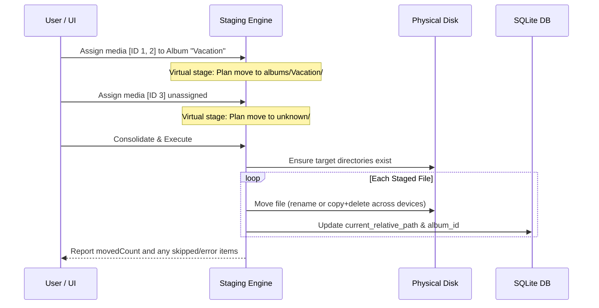

# Logic Feature 03: File Operations, Staging & Album Consolidation

## 1. Overview
A core tenet of the External Drive Media Organizer is **explicit user control**: files are never moved automatically in the background. The user organizes media virtually in a **staging model**, and then executes a manual **"Consolidate & Execute"** action that moves files physically on the drive and updates the SQLite database.

---

## 2. Directory Layout on Drive

When a drive is scaffolded, it follows a structured folder hierarchy:

```
<DriveRoot>/
├── .media_library.db          # Portable SQLite Database
├── .media_backups/            # Database backups
├── .media_thumbnails/         # Cached thumbnails (.webp)
├── albums/                    # Physical album directories
│   ├── Vacation 2026/         # Album 1 files
│   └── Family/                # Album 2 files
├── unknown/                   # Fallback consolidation folder for unassigned items
└── [incoming / unorganized files] # Original locations before staging execution
```

---

## 3. Staging & Execution Logic



---

## 4. Key Operations & Safeguards

1. **Safe Atomic Move (`internal/fileops/move.go`)**:
   - First attempt `os.Rename(src, dst)`. On the same filesystem/partition, this is atomic and instant.
   - If `os.Rename` fails with `EXDEV` (cross-device link), fallback to buffered copy (`io.Copy`), verify source and destination byte lengths and SHA-256 hash match, then delete the source.
2. **Name Collision Resolution (`internal/fileops/naming.go`)**:
   - If destination `albums/Vacation/photo.jpg` already exists:
     - Compare hashes: if identical, link existing or deduplicate.
     - If distinct, append collision suffix: `photo_1.jpg`, `photo_2.jpg`.
3. **Rollback & Transactional Safety**:
   - Record an execution journal of completed file moves.
   - If a catastrophic error occurs mid-batch (e.g. out of disk space), allow the user to roll back completed moves or record exact state in `.media_library.db`.
4. **Album Management Operations**:
   - **Create Album**: Creates album record in DB and directory `albums/<name>/`.
   - **Edit Album**: Renames album in DB and physically renames directory `albums/<oldName>/` -> `albums/<newName>/`. Updates all member paths in DB.
   - **Delete Album**:
     - *Soft delete*: Disassociates album in DB; files moved back to `unknown/` or original path.
     - *Permanent delete*: Deletes media records and sends files to OS trash or deletes them physically after confirmation.
   - **Merge Albums**: Moves all files from `albums/<source>/` into `albums/<target>/`, updates database records, and removes empty `<source>` folder.
   - **Validate & Rescan**: Checks disk files against DB records; flags missing files and restores unindexed files.

---

## 5. File Structure
- `internal/fileops/staging.go`: Staging state and execution engine.
- `internal/fileops/move.go`: Safe file movement with cross-filesystem fallback.
- `internal/fileops/naming.go`: Path sanitization, Unicode normalization, collision resolution.
- `internal/fileops/scaffold.go`: Initialization of library folders (`albums/`, `unknown/`, `.media_thumbnails/`).

---

## 6. Acceptance Criteria
- [ ] Staging state allows queueing file assignments without touching the disk.
- [ ] "Consolidate & Execute" moves files physically to `albums/<album>/` and `unknown/`.
- [ ] Name collisions are resolved safely without overwriting existing files.
- [ ] Database paths (`current_relative_path`) accurately reflect new disk locations.
- [ ] Unit tests verify cross-device fallbacks and collision renaming.
