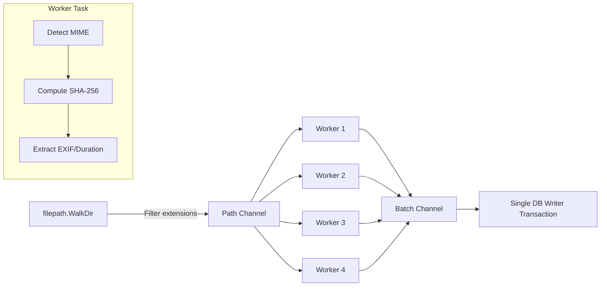

# Logic Feature 04: Media Scanner, Duplicate Hashing & Metadata Indexing

## 1. Overview
The scanner walks a specified directory on an external drive, identifies supported media files (images, videos, audio), extracts EXIF and codec metadata, computes duplicate-detecting content hashes (SHA-256), and registers them into the drive's SQLite database.

---

## 2. Dependencies & Package Selection
- **MIME Detection**: `github.com/h2non/filetype`
  - *Rationale*: Pure Go magic-byte scanner; does not require external `libmagic` C libraries.
- **EXIF Extraction**: `github.com/rwcarlsen/goexif/exif`
  - *Rationale*: Robust pure Go EXIF reader for camera model, ISO, shutter speed, date taken, GPS coordinates, and orientation.
- **Video Metadata**:
  - `ffprobe` (via JSON output) or lightweight MP4 atom parser (`github.com/abema/go-mp4` or `github.com/alfg/mp4`) for video duration, resolution, and codec.

---

## 3. Supported Media Formats

| Category | File Extensions | MIME Types |
| :--- | :--- | :--- |
| **Images** | `.jpg`, `.jpeg`, `.png`, `.webp`, `.gif`, `.heic`, `.bmp`, `.tiff` | `image/jpeg`, `image/png`, `image/webp`, `image/gif`, `image/heic` |
| **Videos** | `.mp4`, `.mov`, `.avi`, `.mkv`, `.webm`, `.m4v`, `.flv` | `video/mp4`, `video/quicktime`, `video/x-matroska`, `video/webm` |
| **Audio** | `.mp3`, `.m4a`, `.wav`, `.flac`, `.aac`, `.ogg` | `audio/mpeg`, `audio/mp4`, `audio/wav`, `audio/flac` |

---

## 4. Concurrent Scanning Pipeline

### Pipeline Principles
1. **Parallel Worker Pool**:
   - Number of workers: `runtime.NumCPU()`.
   - File reads, hashing, and EXIF extraction happen concurrently across CPU cores.
2. **Chunked Hashing Optimization**:
   - For fast duplicate screening on files >100 MB: compute a fast sparse hash (first 64 KB + middle 64 KB + last 64 KB + file size). Full SHA-256 is only calculated if a duplicate candidate matches the fast hash.
3. **Batched SQLite Inserts**:
   - Database writes must **not** occur per-file across goroutines (which causes lock contention).
   - Workers push parsed items into a collector channel. A single writer goroutine commits batches of 200 items in a single transaction.
4. **Pause, Resume & Cancel**:
   - Controlled via `context.WithCancel` and a pause mutex / channel gate.
   - Progress reports (scanned files, discovered media, current path) are sent through a channel to the UI bridge.

---

## 5. File Structure
- `internal/scanner/scanner.go`: Scanner orchestrator, worker pool, lifecycle (`Start`, `Stop`, `Pause`, `Status`).
- `internal/scanner/mime.go`: MIME sniffing and extension fallback.
- `internal/scanner/hasher.go`: SHA-256 and fast sparse hashing.
- `internal/scanner/metadata.go`: EXIF parser, orientation detection, video duration extractor.
- `internal/scanner/ignore.go`: Default ignore filters (`.git`, `node_modules`, `System Volume Information`, `.Trashes`).

---

## 6. Acceptance Criteria
- [ ] Recursively scans 10,000 files in under 10 seconds (on SSD).
- [ ] Detects identical duplicate files via SHA-256 hash.
- [ ] Extracts date taken, camera model, and GPS latitude/longitude into `metadata_json`.
- [ ] Allows pause, resume, and cancellation without leaving locked DB states.
