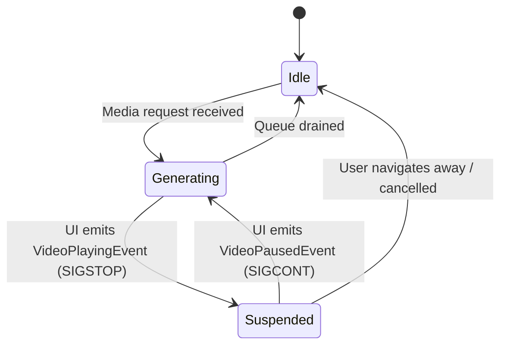

# Logic Feature 05: Thumbnail Pipeline, Caching & CPU Throttling

## 1. Overview
The thumbnail pipeline generates, resizes, and caches preview images for photos and videos. Video software decoding pins multiple CPU cores; therefore, a critical requirement is **CPU throttling**: the pipeline must immediately suspend thumbnail generation (`SIGSTOP`) when a video is being played in the UI, and resume (`SIGCONT`) upon pause or stop.

---

## 2. Dependencies & Package Selection
- **Image Resizing**: `golang.org/x/image/draw` or `github.com/disintegration/imaging`
  - *Rationale*: Pure Go high-quality bicubic/lanczos image downsampling for JPEG/PNG/WebP.
- **Video Thumbnails**: `ffmpeg` CLI subprocess
  - Spawns `ffmpeg -ss <time> -i <video> -vframes 1 -vf scale=320:-1 <output.webp>`.
- **In-Memory Cache**: LRU cache (e.g. `github.com/hashicorp/golang-lru/v2`) holding decoded `image.Image` / `ui.Bitmap` instances.

---

## 3. Storage & Cache Hierarchy

1. **L1: In-Memory LRU Cache**:
   - Holds 200–500 most recently viewed thumbnails in RAM. Instant UI display.
2. **L2: On-Disk Persistent Cache**:
   - Location: `<driveRoot>/.media_thumbnails/<hash[:2]>/<hash>.webp`.
   - Storing on the drive ensures thumbnails do not need re-generating when the drive is moved to another computer.
3. **L3: Just-In-Time Generation**:
   - Triggered on demand if missing from L1 and L2.

---

## 4. CPU Throttling Mechanism (SIGSTOP / SIGCONT)



### Throttling Implementation
```go
package thumbnail

import (
    "os/exec"
    "sync"
    "syscall"
)

type Throttler struct {
    mu       sync.Mutex
    paused   bool
    activeCmds map[int]*exec.Cmd // PID -> Cmd
}

func (t *Throttler) Pause() {
    t.mu.Lock()
    defer t.mu.Unlock()
    if t.paused { return }
    t.paused = true
    for pid := range t.activeCmds {
        // Suspend ffmpeg processes at the OS level
        _ = syscall.Kill(pid, syscall.SIGSTOP)
    }
}

func (t *Throttler) Resume() {
    t.mu.Lock()
    defer t.mu.Unlock()
    if !t.paused { return }
    t.paused = false
    for pid := range t.activeCmds {
        // Resume execution without restarting from scratch
        _ = syscall.Kill(pid, syscall.SIGCONT)
    }
}
```
*Note for Windows*: On Windows, where `SIGSTOP` is unavailable, pause suspends threads via `SuspendThread` / `ResumeThread` API or halts worker dequeueing.

---

## 5. File Structure
- `internal/thumbnail/service.go`: Orchestrator, public `GetThumbnail(ctx, mediaItem)` API.
- `internal/thumbnail/image.go`: Pure Go image downsampling (JPEG, PNG, WebP).
- `internal/thumbnail/video.go`: Ffmpeg frame grabber with seek offset heuristics.
- `internal/thumbnail/throttler.go`: Process registry, pause gate, SIGSTOP/SIGCONT controls.
- `internal/thumbnail/cache.go`: Disk store (`.media_thumbnails/`) and memory LRU.

---

## 6. Acceptance Criteria
- [ ] Image thumbnails are generated in under 50ms per item.
- [ ] Video thumbnails extract an early representative frame using ffmpeg.
- [ ] Active generation halts immediately when `Pause()` is called.
- [ ] Thumbnails are persistently stored on the drive in WebP format.
