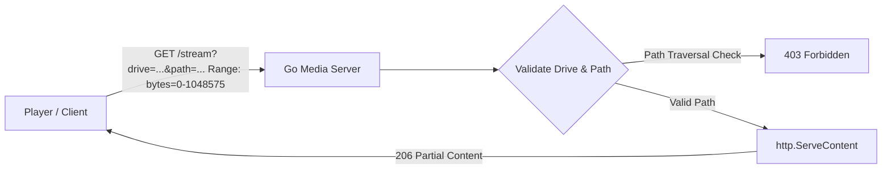

# Logic Feature 06: Local Media Streaming HTTP Server

## 1. Overview
The application embeds a lightweight, high-performance local HTTP server on port `51789` (configurable). This server streams video and audio files to local players, network clients, and mobile devices, supporting HTTP 206 Partial Content (Range requests) for fast seeking and scrubbing.

---

## 2. Standard Go Advantages
Unlike the Bun implementation which required manual chunked byte-range slicing (`MAX_CHUNK_SIZE = 50 MB`), Go's standard library `net/http` provides native, battle-tested range request support through `http.ServeContent` and `http.ServeFile`.

---

## 3. Streaming Architecture & Security

### Path Traversal Defense
Because the server accepts file paths, it must strictly prevent arbitrary filesystem access:
1. `filepath.Clean` and `filepath.EvalSymlinks` on the requested path.
2. Verify that the resolved canonical path starts with the active `drivePath`.
3. Verify that the requested file exists in the active `.media_library.db` database.

---

## 4. Endpoints

| Endpoint | Method | Description |
| :--- | :--- | :--- |
| `/stream` | GET, HEAD | Streams media file with `Range` header support. |
| `/thumbnail` | GET | Serves cached WebP thumbnail for given `mediaId`. |
| `/health` | GET | Returns server status and active drive info. |

### Header Configuration
- `Accept-Ranges: bytes`
- `Content-Type`: Exact MIME type (`video/mp4`, `video/webm`, `audio/mpeg`, etc.).
- `Access-Control-Allow-Origin: *` (allows embedded players and local web views).
- `Cache-Control: public, max-age=31536000` (for immutable hash-addressed thumbnails).

---

## 5. File Structure
- `internal/server/stream/server.go`: HTTP server initialization, port binding, graceful shutdown.
- `internal/server/stream/handlers.go`: Stream handler, validation, thumbnail endpoint.
- `internal/server/stream/security.go`: Path boundary verification and drive sandboxing.

---

## 6. Acceptance Criteria
- [ ] Supports HTTP 206 Range requests with byte seeking in under 5ms.
- [ ] Correctly rejects paths outside the active drive root (403 Forbidden).
- [ ] Shuts down cleanly on app exit without hanging listeners.
