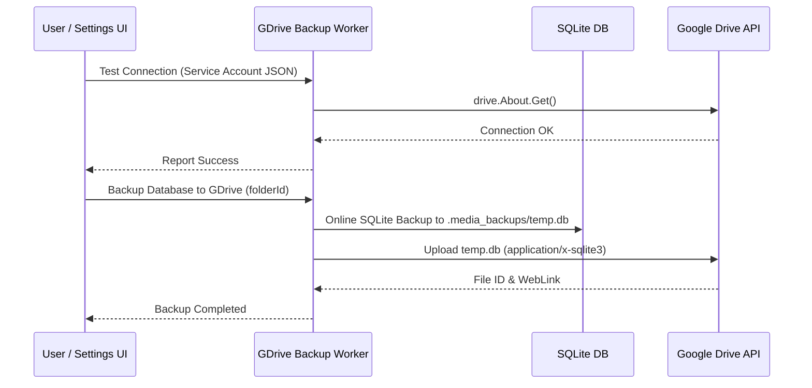

# Logic Feature 08: Google Drive Cloud Backup Service

## 1. Overview
Enables backing up the external drive's `.media_library.db` metadata database and selected album files to Google Drive using a Google Cloud Service Account JSON key.

---

## 2. Dependencies & Package Selection
- **Official SDK**: `google.golang.org/api/drive/v3`
  - *Rationale*: Official, supported Google Drive API v3 client for Go.
- **Authentication**: `google.golang.org/api/option` with `option.WithCredentialsJSON([]byte(serviceAccountJSON))`.

---

## 3. Workflow & Architecture

---

## 4. Key Functions

1. **`TestConnection(ctx context.Context, serviceAccountJSON string, folderID string) error`**:
   - Validates JSON format and calls `driveService.Files.Get(folderID)` to ensure write permissions exist.
2. **`BackupDatabase(ctx context.Context, driveRoot string, serviceAccountJSON string, folderID string) (*UploadResult, error)`**:
   - Takes an online snapshot of `.media_library.db` (safe against concurrent reads/writes).
   - Names upload `media_library_backup_<timestamp>.db`.
   - Uploads with mime-type `application/x-sqlite3`.
   - Cleans up temporary snapshot file.

---

## 5. File Structure
- `internal/gdrive/client.go`: Service account authentication and Google Drive client constructor.
- `internal/gdrive/backup.go`: Database and folder backup routines.
- `internal/gdrive/test.go`: Connection validation.

---

## 6. Acceptance Criteria
- [ ] Validates service account JSON credentials with error diagnostics.
- [ ] Uploads database snapshot without locking the active database.
- [ ] Respects user cancellation during upload.
